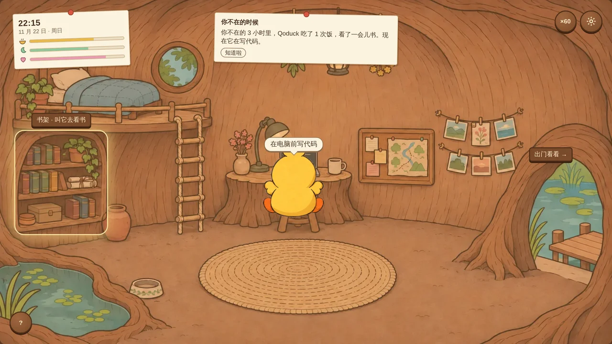
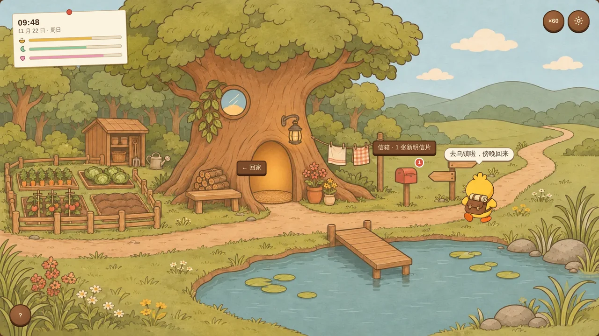

# 界面 Spec：场景即界面（v1）

> 11-22。起因：按钮、状态条、说明文字都在场景外面，像「网页上贴了一张图」，不沉浸。
> 目标：**整个页面只有这个树洞世界**，界面元素都长得像世界里的东西：钉在墙上的便签、木头按钮、木牌，并且都放在场景里面。
> 样稿：`docs/spec/ui-mock/`。两张 HTML 可以直接用浏览器打开，三张 webp 是截图。
> 排期：约 2 小时。建议在 Quest 3a 之后、3b 之前做，3b 的邮箱、明信片直接按这里的样式来。

| 屋内（电脑 1280×720） | 屋外（旅行中） |
|---|---|
|  |  |

---

## 1. 去掉的东西

| 现在 | 改成 |
|---|---|
| 页面标题「小黄鸭的家」和副标题 | 从页面上去掉。浏览器标签页标题保留。可选：首次打开时显示开场木牌（第 5 节） |
| 场景上方的状态条 | 场景左上角的日历便签（2.1） |
| 场景下方的「屋内 / 屋外」按钮 | 去掉。点门进出（2.3） |
| 场景下方的 ×1 / ×60 / ×600 三个按钮 | 场景右上角的一个木头圆钮，点一下切一档（2.2） |
| 场景下方的说明文字、页脚「第一阶段开发中」 | 去掉。改为左下角的「?」钮（2.5） |

## 2. 场景里的元素

**所有元素都放在 `.scene` 里面，用场景百分比定位，字号用 `clamp(最小px, vw, 最大px)`，这样场景缩放时一起缩放。**

### 2.1 日历便签（左上）

- 位置：`left 2.2%; top 3.5%; width 19%`，旋转 −2°，顶部一颗红色图钉。
- 内容：
  - 第一行：大号时间「22:15」；
  - 第二行：「11 月 22 日 · 周日」；
  - 下面三行：图标 + 进度条（饭碗 = 饱腹，月亮 = 体力，心 = 心情）。
- 图标用简单的内联 SVG（样稿 HTML 里有现成的三个），不用 emoji，也不新增图片素材。
- 鼠标悬停在某一行时显示数字，例如「饱腹 68」。
- 旅行中，第二行下面加一行「旅行中 · 乌镇」。

### 2.2 右上角两个木头圆钮

| 钮 | 行为 |
|---|---|
| 快进 | 显示当前档位「×1 / ×60 / ×600」，点一下切到下一档，循环。悬停提示「快进」 |
| 设置 | 齿轮图标，打开现有的设置面板 |

木头样式：径向渐变的棕色圆、深棕描边、底部 3px 阴影，像一块木片。

### 2.3 门 = 切换屋内 / 屋外

- 现有的门热点保留，去掉场景外的切换按钮。
- 悬停门时显示木牌：屋内「出门看看 →」，屋外「← 回家」。
- **触屏设备没有悬停**：门的木牌始终以 70% 不透明度显示，否则新用户找不到出口。

### 2.4 家具热点

- 悬停时：该家具外围出现柔和的暖黄光圈（`box-shadow` 发光，圆角矩形，大小贴合家具），上方显示木牌「书架 · 叫它去看书」。
- 点击行为不变（向鸭子提建议）。
- 每件家具的木牌文字放在 `src/data/scene.ts`：
  - 床「叫它去睡觉」
  - 饭碗「叫它去吃饭」
  - 书架「叫它去看书」
  - 书桌「叫它去写代码」
  - 窗户「叫它去发会儿呆」
  - 地毯「叫它去打个滚」
- 3b 新增的热点也照这个样式：邮箱「信箱 · 1 张新明信片」，路牌「建议它出去走走」，照片墙「看看明信片」。

### 2.5 左下角「?」钮

- 点一下：所有可点的东西同时发光、显示木牌，持续 3 秒后淡出。代替原来的说明文字。
- 第一次打开页面时自动播放一次。

### 2.6 「你不在的时候」便签

- 位置：顶部居中，`top 4%; width 30%`，旋转 1°，顶部图钉。样式与日历便签相同。
- 「知道啦」做成小圆角描边按钮。3b 的「去邮箱看看」按钮放在它旁边。

### 2.7 鸭子的气泡

- 改成纸色对话气泡：圆角，下方有一个小尖角指向鸭子，深棕描边，底部 2px 阴影。

### 2.8 聊天面板

- 行为不变，样式改成同一套纸张风格：纸色底、深棕描边、标题处一颗图钉。
- 不要整屏遮住场景：电脑上占场景下半部分居中，约 60% 宽。

## 3. 页面和外框

- 页面背景：深木色 `#3b2618`。
- 场景居中，保持 16:9，尽量撑满窗口：`width: min(100vw, 100vh * 16 / 9)`。
- 外框：圆角 10px，6px 深木色描边，外阴影，像一个画框。
- 页面不滚动。

## 4. 手机

| 情况 | 做法 |
|---|---|
| 横屏 | 和电脑一样，全部元素随场景缩放（样稿 `mock-phone-landscape.webp`，844×390） |
| 竖屏 | 场景只有约 200px 高，元素叠在场景上会挡住全部画面。所以竖屏时，日历便签、「你不在的时候」便签和聊天面板放在**场景下方**的一块木色面板里。木头圆钮和「?」钮缩小后仍留在场景里。场景下方加一行小字「横过来看更舒服」 |

断点：`(max-width: 600px) and (orientation: portrait)`。

## 5. 可选：开场木牌

首次打开时（每次会话一次），在屋外场景上叠一块木牌：
- 标题「小黄鸭的家」；
- 副标题「给只活在聊天框里的 AI 一个看得见的家」；
- 按钮「推门进去」。

点了之后进入屋内。这是评委的第一眼，也顺便说清楚这是什么。时间不够可以不做。

## 6. 样式变量

| 名称 | 值 | 用途 |
|---|---|---|
| `--paper` | `#fbf3df` | 便签、气泡底色 |
| `--paper-line` | `#c9ab82` | 便签描边 |
| `--wood` / `--wood-light` | `#7a4a2a` / `#a0673f` | 木头钮、木牌 |
| `--wood-dark` | `#4e2e18` | 木头描边 |
| `--ink` / `--ink-soft` | `#4a3020` / `#7a5c44` | 文字 |
| `--pin` | `#d9573f` | 图钉、未读红点 |

## 7. 不变的东西

- 所有美术素材不改，不新增图片（图标是内联 SVG，便签、木牌都用 CSS）。
- 热点坐标、鸭子锚点不变。
- 所有按钮保留 `aria-label`；键盘可以聚焦并看到焦点框；「减少动态效果」开启时不播放发光动画，直接显示。

---

## 交给 Qoder 的话

> 请先合并远程的 `claude` 分支，然后阅读 `docs/spec/界面-场景即界面.md`。用浏览器打开 `docs/spec/ui-mock/interior.html` 和 `exterior.html` 看样稿（可以直接参考里面的 CSS 和 SVG 图标）。完成以下内容：
>
> - 去掉场景外的标题、状态条、屋内/屋外按钮、快进按钮和说明文字。
> - 在场景里加入：
>   - 左上日历便签；
>   - 右上快进和设置两个木头圆钮；
>   - 门的木牌（触屏时常显）；
>   - 家具悬停光圈和木牌（文字放 `src/data/scene.ts`）；
>   - 左下「?」钮（首次打开自动播放一次）。
> - 「你不在的时候」、气泡、聊天面板统一成纸张样式。
> - 页面改为深木色背景、16:9 场景撑满窗口、不滚动。
> - 竖屏手机按第 4 节处理。
> - 第 5 节开场木牌可选，最后有时间再做。
>
> 不要改动 `public/art/` 下的任何素材，不新增图片。完成后运行构建和测试，在 1280×720、844×390、375×740 下各截一张屋内图，存到 `docs/screenshots/`。
